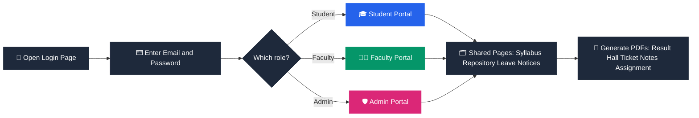

<table width="100%" align="center">
  <tr>
    <td width="20%" align="center" valign="middle">
      
    </td>
    <td width="60%" align="center" valign="middle">
      
    </td>
    <td width="20%" align="center" valign="middle">
      
    </td>
  </tr>
</table>

<div align="center">

<h3>Student Management System — One Login, Three Portals</h3>


<br/>

<a href="https://shahrishabh1513-jsk.github.io/RT-SMS-Student-Manegment-System/"></a>
<a href="https://github.com/shahrishabh1513-jsk/RT-SMS-Student-Manegment-System"></a>
<a href="https://github.com/shahrishabh1513-jsk/RT-SMS-Student-Manegment-System/stargazers"></a>
<a href="#-demo-logins"></a>

<br/><br/>


<br/><br/>


</div>

<br/>

<div align="center">

[](#-live-preview)
[](#-about-the-project)
[](#-key-features)
[](#-demo-logins)
[](#-how-it-works)
[](#-tech-stack)
[](#-project-structure)
[](#-getting-started)
[](#-connect)

</div>

<div align="center"></div>

## 🔍 Live Preview

<div align="center">

<table width="90%">
<tr>
<td>🔴 🟡 🟢 &nbsp;&nbsp; <code>shahrishabh1513-jsk.github.io/RT-SMS-Student-Manegment-System</code></td>
</tr>
<tr>
<td align="center">
<a href="https://shahrishabh1513-jsk.github.io/RT-SMS-Student-Manegment-System/" target="_blank">

</a>
</td>
</tr>
</table>

<br/>

<a href="https://shahrishabh1513-jsk.github.io/RT-SMS-Student-Manegment-System/" target="_blank"></a>
<a href="#-demo-logins"></a>

</div>

> 💡 The preview shows the login screen — the portals sit behind the role-based login. Use the demo accounts below to look around.

<div align="center"></div>

## 📖 About The Project

<table>
<tr>
<td width="60%" valign="top">

**RT SMS** is a front-end **Student Management System** with separate portals for **students, faculty and admins**. One login page checks who you are and sends you to the right portal — each with its own menus and pages.

Behind the portals sit shared academic pages (syllabus, repository, leave, notices and more) and a built-in **PDF engine** that produces results, hall tickets, syllabus books, notes and assignments. It runs entirely in the browser with plain **HTML, CSS and JavaScript**, using demo seed data.

> 💡 *Designed & Developed by RT1504.*

</td>
<td width="40%" valign="top">

| At a glance | |
|---|---|
| 🎓 **Type** | Student management web app |
| 👥 **Roles** | Student · Faculty · Admin |
| 📄 **PDFs** | Result, hall ticket, syllabus book, notes, assignment |
| 🎨 **Theme** | Clean light UI |
| 🧪 **Data** | Demo seed data included |

</td>
</tr>
</table>

<div align="center"></div>

## ✨ Key Features

<table>
<tr>
<td width="50%" valign="top" align="center">


<div align="left">

- One login page for everyone
- Redirects automatically by role
- Login is shared between pages
- Demo accounts for Admin, Faculty & Student

</div>

</td>
<td width="50%" valign="top" align="center">


<div align="left">

- **Student portal** — `student.html`
- **Faculty portal** — `teacher.html`
- **Admin portal** — `admin.html`
- Role-specific menus and pages for each

</div>

</td>
</tr>
<tr>
<td width="50%" valign="top" align="center">


<div align="left">

- Subjects and full syllabus content
- Results maths built in
- Demo seed data to explore with
- Shared state, helpers and routing

</div>

</td>
<td width="50%" valign="top" align="center">


<div align="left">

- Result PDFs
- Hall tickets
- Syllabus book
- Notes and assignments
- Embedded logo on every PDF

</div>

</td>
</tr>
<tr>
<td width="50%" valign="top" align="center">


<div align="left">

- Syllabus and repository
- Leave management
- Notices
- …and more, shared across roles

</div>

</td>
<td width="50%" valign="top" align="center">


<div align="left">

- Clean light theme, one stylesheet
- QR and PDF libraries for documents
- Runs with Live Server — no build step
- Plain HTML, CSS and JavaScript

</div>

</td>
</tr>
</table>

<div align="center"></div>

## 🔑 Demo Logins

Try each portal with the demo accounts — **the password for all of them is `pass123`**.

<div align="center">

| Portal | Email | ID | Open |
|:---:|---|---|:---:|
| 🛡️ **Admin** | `admin@rtsms.com` | `RTSMSAD001` | [](https://shahrishabh1513-jsk.github.io/RT-SMS-Student-Manegment-System/) |
| 👩‍🏫 **Faculty** | `neha@rtsms.com` … `khushali@rtsms.com` | `RTSMSFE001` – `RTSMSFE008` | [](https://shahrishabh1513-jsk.github.io/RT-SMS-Student-Manegment-System/) |
| 🎓 **Student** | `rishabh@rtsms.com` … | `23SS02IT001` – `23SS02IT012` | [](https://shahrishabh1513-jsk.github.io/RT-SMS-Student-Manegment-System/) |

</div>

> ℹ️ These are demo accounts with seed data, meant only for trying the app.

<div align="center"></div>

## 🧭 How It Works



<div align="center"></div>

## 🧰 Tech Stack

<div align="center">

| Layer | Technology | Purpose |
|:---:|:---:|:---|
| **Structure** |  | One page per portal |
| **Styling** |  | Light theme in a single stylesheet |
| **Logic** |  | State, routing, results maths & role pages |
| **Documents** | PDF & QR libraries | Results, hall tickets, notes & assignments *(loaded online)* |
| **Version Control** |   | Source control |
| **Hosting** |  | Live deployment |

</div>

<p align="center"><b>No build tools · No <code>npm install</code> · No bundlers — clone it and open it.</b></p>

<div align="center"></div>

## 📂 Project Structure

<details>
<summary><b>Click to expand the folder structure 📁</b></summary>

```bash
RT-SMS-Student-Manegment-System/
│
├── index.html          # Login page → redirects by role
├── student.html        # Student portal
├── teacher.html        # Faculty portal
├── admin.html          # Admin portal
│
├── assets/
│   ├── css/
│   │   └── style.css   # All styling (light theme)
│   ├── images/
│   │   └── rt-sms-logo.png
│   └── js/
│       ├── logo.js     # Embedded logo (used inside PDFs)
│       ├── data.js     # Subjects, syllabus content, demo seed data
│       ├── core.js     # State, helpers, layout, router, results maths
│       ├── pdf.js      # PDFs: result, hall ticket, syllabus book, notes, assignment
│       ├── shared.js   # Pages used by several roles (syllabus, repository, leave, notices…)
│       ├── auth.js     # Login page logic
│       ├── student.js  # Student menus & pages
│       ├── teacher.js  # Faculty menus & pages
│       └── admin.js    # Admin menus & pages
│
└── README.md
```

</details>

<div align="center"></div>

## 🚀 Getting Started

<table>
<tr>
<td width="50%" valign="top">

**Option 1 — Use the live app**

No setup needed 👉 **[Open RT SMS](https://shahrishabh1513-jsk.github.io/RT-SMS-Student-Manegment-System/)**

Then sign in with one of the [demo logins](#-demo-logins).

</td>
<td width="50%" valign="top">

**Option 2 — Run it locally**

```bash
git clone https://github.com/shahrishabh1513-jsk/RT-SMS-Student-Manegment-System.git
cd RT-SMS-Student-Manegment-System

# recommended: serve it so login is shared between pages
python -m http.server 8000
# or use VS Code "Live Server"
```

Then open `http://localhost:8000`.

</td>
</tr>
</table>

> ℹ️ Opening `index.html` directly also works in Chrome and Edge. An **internet connection is needed** for the fonts and the PDF and QR libraries.

<div align="center"></div>

## 🎯 Roadmap

<table>
<tr>
<td width="50%" valign="top">

**✅ Done**
- [x] Role-based login with three portals
- [x] Shared pages: syllabus, repository, leave, notices
- [x] PDF generation: results, hall tickets, notes, assignments
- [x] Demo seed data and accounts

</td>
<td width="50%" valign="top">

**🚧 Up next**
- [ ] 🗄️ Real backend and database
- [ ] 🔐 Secure authentication
- [ ] 🔔 Email / SMS notices
- [ ] 📈 Analytics dashboard
- [ ] 🌙 Dark mode

</td>
</tr>
</table>

<div align="center"></div>

## 🤝 Connect

<div align="center">

**Rishabh Alpeshabhai Shah**

<a href="https://rishabh-shah-portfolio.netlify.app/"></a>
<a href="https://www.linkedin.com/in/rishabh-alpeshabhai-shah-91b9072a6/"></a>
<a href="mailto:shahrishu1515@gmail.com"></a>
<a href="https://github.com/shahrishabh1513-jsk"></a>

<br/><br/>

### ⭐ If this project helped you, consider giving it a star!


<br/>

**Made with 🎓 & ❤️ by Rishabh Shah**


</div>
